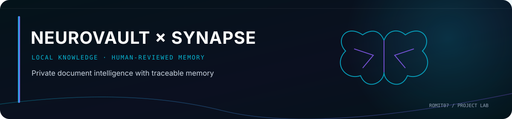

<p align="center">
  
</p>

# NeuroVault + Synapse Active Brain — V0

A small, local-first document knowledge app. NeuroVault extracts and indexes your PDF, DOCX, and UTF-8 TXT files, then answers questions using a local Ollama model and linked excerpts. Synapse Active Brain V0 keeps a small structured memory of explicitly worded facts and asks you to review conflicting or updated facts before changing that memory.

This is a **single-user local demo**, not a cloud service. No API key, account, GPU, or model weights are included.

## Architecture

```text
Document → validation → extraction → chunking → local all-MiniLM-L6-v2 embeddings
         → SQLite vector storage → FAISS search index → retrieval
         → local Ollama LLM → grounded answer + cited sources

New information → deterministic fact patterns → compare structured SQLite memory
                → classify relationship → pending alert → human decision
                → update / keep existing / keep both
```

SQLite holds document text, metadata, chunks, 384-dimensional embedding bytes, memories, sources, and alerts. FAISS is an in-memory search index rebuilt from SQLite on backend startup; restart does not require re-embedding or re-uploading. The source inspector shows extracted text and chunks. Original binary files are not stored. NeuroVault uses CPU embeddings by default. The only runtime model request is to Ollama at `127.0.0.1`.

ChangeGuard recognizes narrow explicit patterns such as `Machine Learning assignment deadline is 14 October 2026` and `... deadline has been extended to 18 October 2026`. It classifies new facts as `NEW_INFORMATION`, `DUPLICATE`, `RELATED_INFORMATION`, `POTENTIAL_UPDATE`, or `CONTRADICTION`. A duplicate adds another source to the existing memory; a related fact is stored separately. A potential update or contradiction becomes a pending alert. **Neither classification replaces important memory without your decision.** Rule confidence is a heuristic score, not a calibrated probability.

## Requirements

- Windows 10/11 x64, Python **3.11 or 3.12** with the `py` launcher, Node.js **20.19+** and npm.
- At least 8 GB free disk space for Python dependencies, the embedding download, and a small Qwen model; exact use varies by platform and PyTorch wheel. 16 GB RAM is suitable. No CUDA requirement.
- Ollama for generated answers. Recommended model: [`qwen2.5:3b`](https://ollama.com/library/qwen2.5) (listed at approximately 1.9 GB). The app can ingest and detect changes without Ollama, but Q&A generation requires it.
- Internet access during the **initial** `pip`/`npm` installations and `ollama pull`, plus the first embedding-model download from Hugging Face. Thereafter, normal app use is local. The embedding model is [`sentence-transformers/all-MiniLM-L6-v2`](https://huggingface.co/sentence-transformers/all-MiniLM-L6-v2).

Use a normal PowerShell window. From the folder containing this README:

## 1. Backend setup and startup (PowerShell terminal 1)

```powershell
cd .\backend
py -3.11 -m venv .venv
.\.venv\Scripts\Activate.ps1
python -m pip install --upgrade pip
python -m pip install -r requirements.txt
python -m uvicorn app.main:app --host 127.0.0.1 --port 8000
```

If you only have Python 3.12, replace `py -3.11` with `py -3.12`. If PowerShell blocks activation, call `.\.venv\Scripts\python.exe -m pip install -r requirements.txt` and `.\.venv\Scripts\python.exe -m uvicorn app.main:app --host 127.0.0.1 --port 8000` directly instead. Keep this terminal open. Check `http://127.0.0.1:8000/api/health` for local status.

Backend settings have safe defaults. To change them, copy the root `.env.example` to `backend/.env` and edit that private file. Data is stored at `backend/data/neurovault.sqlite3`; back up this file if you care about your indexed knowledge. Do not put private data in `sample-data` or in Git.

## 2. Ollama setup (PowerShell terminal 2)

Install [Ollama for Windows](https://ollama.com/download/windows) and start its desktop app. Then:

```powershell
ollama pull qwen2.5:3b
ollama list
```

Ollama usually runs in the background on Windows. If it is not running, start the Ollama app or run `ollama serve` in a separate terminal. The dashboard health panel reports whether it can reach the configured model. To switch models later, set `OLLAMA_MODEL` in `backend/.env` to a model you have already pulled and restart the backend. Ollama must listen only on localhost for this project.

## 3. Frontend setup and startup (PowerShell terminal 3)

From the project root:

```powershell
cd .\frontend
npm ci
npm run dev
```

Open `http://127.0.0.1:5173`. The Vite script binds to localhost and uses port 5173. The backend listens only at `127.0.0.1:8000`. If either port is occupied, close the conflicting process; V0 uses fixed local ports. The first upload may take longer while the embedding model downloads and loads on CPU. Keep the browser tab open until it finishes.

## Demo walkthrough

1. On **Documents**, upload `sample-data/assignment-original.txt`.
2. Upload `sample-data/assignment-update.txt`. The upload result reports one `POTENTIAL_UPDATE` and the **Synapse Alerts** page shows both deadlines, both source filenames, the rule reason, and three actions.
3. Before a decision, **Memory** still lists 14 October. Choose **Accept Update** to supersede it with 18 October, **Keep Existing** to retain 14 October, or **Keep Both** to preserve both values as structured memory.
4. Ask “What is the Machine Learning assignment deadline?” on **Ask NeuroVault**. If Ollama is installed, the answer should cite source markers; inspect the retrieved excerpts below it. Because both documents are searchable even after a memory decision, the answer may mention the conflicting versions. The structured-memory decision does not erase source material.
5. Stop the backend, restart it with the same command, refresh the dashboard, and confirm documents, memories, alerts, and retrieval remain available.

There is no simulated answer if Ollama is missing. You will see a setup error. Uploading and Synapse classification still work.

## Tests and checks

In the activated backend virtual environment:

```powershell
cd .\backend
python -m pip install -r requirements-dev.txt
python -m pytest -q
```

In another terminal from `frontend`:

```powershell
npm ci
npm run typecheck
npm run build
```

Backend tests use a deterministic fake embedder and mocked local LLM; they do not download model weights or need a GPU. A live Ollama and a real model are needed to validate answer quality manually.

## Security and privacy

The API and Vite scripts bind to loopback. The API restricts browser origins and host headers. It checks extension, declared MIME, file signature/structure, UTF-8 encoding, 10 MiB upload size, 100 PDF pages, and 500,000 extracted characters; DOCX decompression is capped. Filenames are sanitized and are display metadata only. Source text is displayed as React text, never executed as HTML. SQLite uses parameterized queries. The app does not run uploaded files, invoke shell commands, add telemetry, or call cloud inference APIs. The initial embedding-model download and dependency/model installation require external package sources. See [SECURITY.md](SECURITY.md) for scope and remaining risks.

## Known limitations

- OCR is absent; image-only or encrypted PDFs cannot be indexed. Complex DOCX layout, headers/footers, and PDF reading order may lose context.
- Fact extraction uses intentionally narrow, English pattern rules for deadlines, dates, location, status, and room. It is not a general semantic memory engine and may miss valid facts or misclassify awkward phrasing.
- Q&A searches **all uploaded documents**, including evidence you chose not to promote into structured memory. Conflicting evidence is shown in retrieved excerpts; decisions do not alter source documents. A small LLM may fail to cite or misread a source. The app rejects uncited answers but does not prove a cited claim is correct.
- Retrieval uses a simple similarity cutoff and four excerpts. It can miss relevant information or retrieve related but insufficient text. No reranker or per-document filter is included.
- Single-user localhost access only; no authentication, delete UI, migration framework, or background indexing. Backup and clearing data are manual. No live model quality test runs in CI.

## Later phases (outside V0)

OCR and better document layout, wider and user-editable fact extraction, semantic conflict assistance with human approval, relevance tuning, per-document search controls, and backup/export tools. No autonomous agents, cloud vector databases, accounts, browser agents, or multi-user features are in this version.
